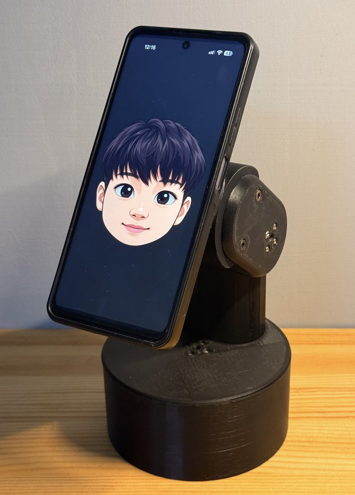
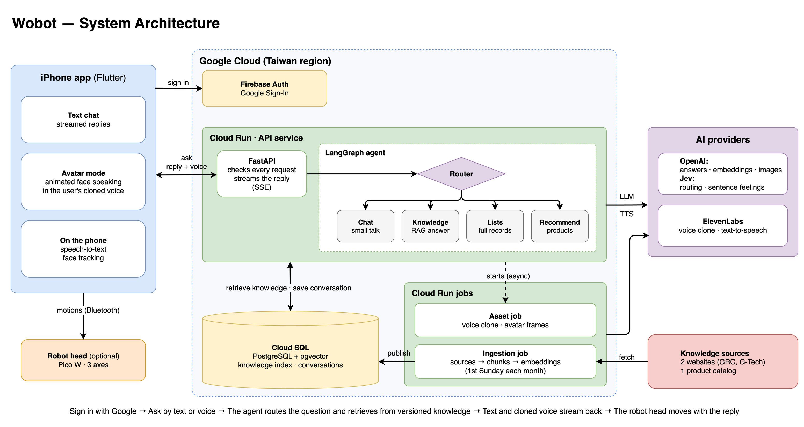
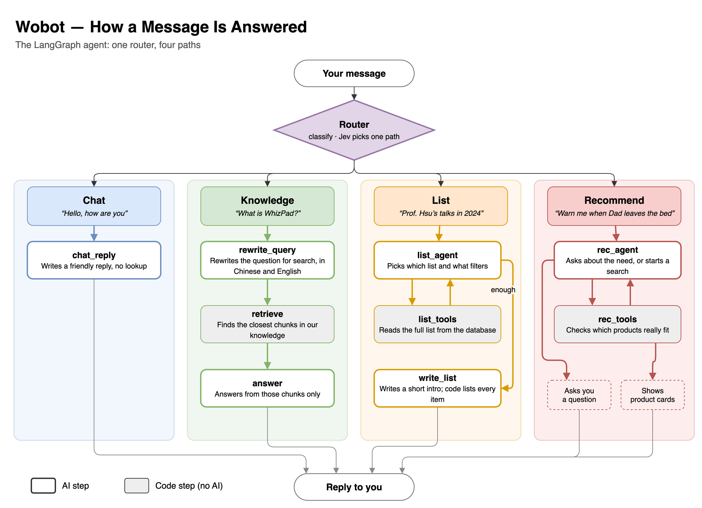
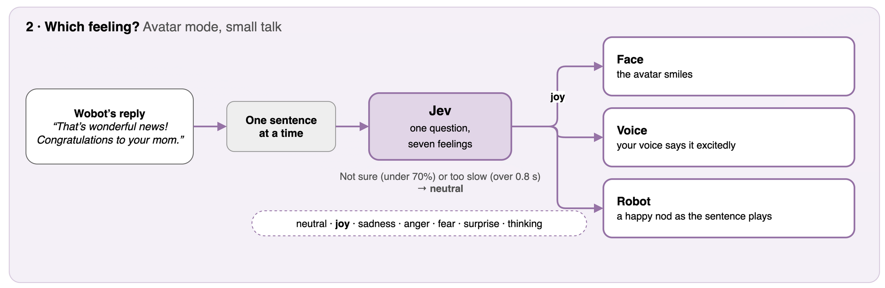

# Wobot

**Wobot is an AI spokesperson you can talk to. It answers from approved sources, shows
your own cartoon face, and speaks in your own cloned voice.**

Wobot speaks for a Gerontechnology Research Center (GRC) and SEDA G-Tech. Ask it
about the two organizations, their people and research, or which smart care product suits a
need. It answers in Chinese or English, by text or by voice.

## What Wobot does

- **Answers questions** from the two websites and a product catalog.
- **Lists records in full**, such as talks, publications, projects and graduates.
- **Recommends smart care products.** It asks about the need, then shows the products that fit.
- **Looks and sounds like you.** Take a photo and record your voice in the app, and
  Wobot makes your avatar and your voice.
- **Moves on a robot head.** The phone sits on a small robot that moves as Wobot talks
  and turns toward your face. The robot is optional.

 

## System architecture

- **The phone app** talks to one API on Cloud Run, and the reply streams back.
- **Every request is checked.** The user must be signed in with Google and be on the
  allowed list.
- **Slow work runs as separate jobs**: updating the knowledge, and making voices and
  avatars.
- **One database** (PostgreSQL with pgvector) holds the knowledge and the conversations.
- **The app holds no secrets.** Only the cloud calls the AI providers, and the cloud
  services use no stored service account keys.

## How a message is answered

The agent is built with LangGraph. The router uses **Jev**, a fast classification model:
it reads each message and picks one of four paths in about 0.2 seconds. If Jev is down,
a GPT model takes over.

| Path | Example | What happens |
| --- | --- | --- |
| Chat | "Hello, how are you" | Writes a friendly reply, with no lookup |
| Knowledge | "What is WhizPad?" | Rewrites the question for search, finds the closest passages, and answers from them only |
| List | "Prof. Hsu's talks in 2024" | Picks the list and filters, then reads every item from the database |
| Recommend | "Warn me when Dad leaves the bed" | Asks about the need, then checks which products fit |

- **Each AI step has its own model.** Each was chosen by testing: correct answers first,
  then speed, then cost.
- **Code writes the facts.** Lists and product cards come from the database, so a phone
  number or a link is never a model's guess.
- **Code decides which products fit.** The model only turns the need into a search.
- **Code sets the reply language**, from the user's latest message.

## See it in action

Every message takes one of four paths. Each video shows one path. Click a picture to
watch it on YouTube.

| Chat | Knowledge | List | Recommend |
| --- | --- | --- | --- |
|  |  |  |  |
| Small talk | Answers from sources | A full list | Product suggestions |

## Avatar, voice and robot

- **Avatar:** an image model draws 21 frames from the user's photo, with seven
  expressions.
- **Voice:** ElevenLabs clones the user's voice and speaks each reply one sentence at a
  time.
- **Feelings:** in small talk, Jev picks a feeling for each sentence, from seven choices.
  The face, the voice and the robot all follow it.
- **When Jev is unsure:** if it is under 70% sure, or takes over 0.8 seconds, the sentence
  stays neutral.
- **Answers stay plain:** answers, lists and recommendations use a neutral tone.
- **Robot:** a Raspberry Pi Pico W moves three servos, and the app sends it motions over
  Bluetooth.
- **Face tracking:** the phone finds the user's face itself, and camera frames never
  leave the phone.

## Knowledge updates

Once a month, a job reads every source and builds a new version of the knowledge.

1. **Read:** fetch the websites, images, PDFs and product catalog.
2. **Split:** cut the content into small passages.
3. **Index:** turn each passage into a vector, so search can find it by meaning.
4. **Check:** make sure nothing was lost.
5. **Publish:** switch Wobot to the new version.

If a source comes back empty, or more than 20% of its records are gone, the new version
waits for a person to approve it. Old versions are kept, so Wobot can go back to one.

## Tech stack

| Area | Tools |
| --- | --- |
| Agent and RAG | LangGraph, LangChain, OpenAI models, Jev, text-embedding-3-small, pgvector, LangSmith |
| Backend | Python, FastAPI, SQLAlchemy (async), Alembic, uv, pytest |
| Google Cloud | Cloud Run (service and jobs), Cloud SQL for PostgreSQL, Cloud Storage, Cloud Scheduler, Secret Manager, Firebase Authentication |
| Delivery | GitHub Actions with Workload Identity Federation |
| App | Flutter (iOS), server-sent events, on-device speech-to-text, Apple Vision |
| Voice and avatar | ElevenLabs voice cloning and text-to-speech, an OpenAI image model |
| Robot | Raspberry Pi Pico W, Arduino (C++), Bluetooth Low Energy |

## Repository

| Path | Contents |
| --- | --- |
| [`backend/`](backend/README.md) | API, chat agent, knowledge updates, evaluation, database migrations |
| [`app/`](app/README.md) | Flutter app: text chat, Avatar mode, robot motions and face tracking |
| [`infra/`](infra/README.md) | Google Cloud setup guide |
| [`firmware/`](firmware/README.md) | Robot head firmware |

A merge to `main` runs the tests and deploys the system.
